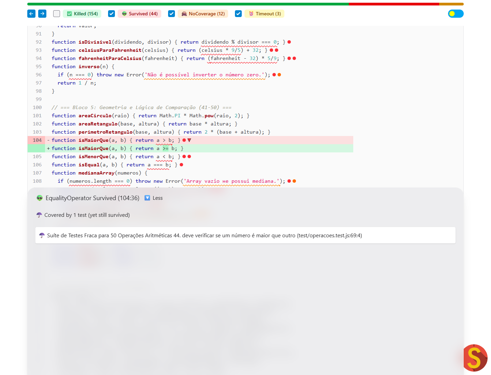
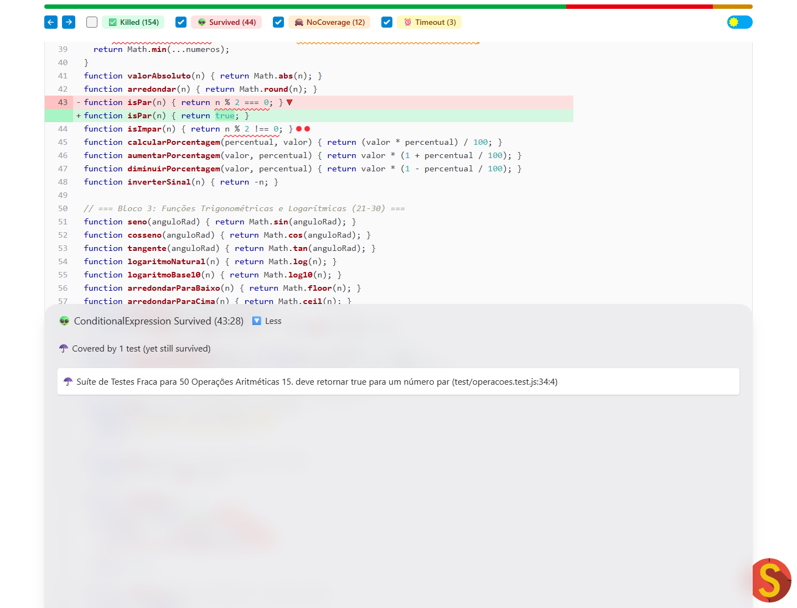
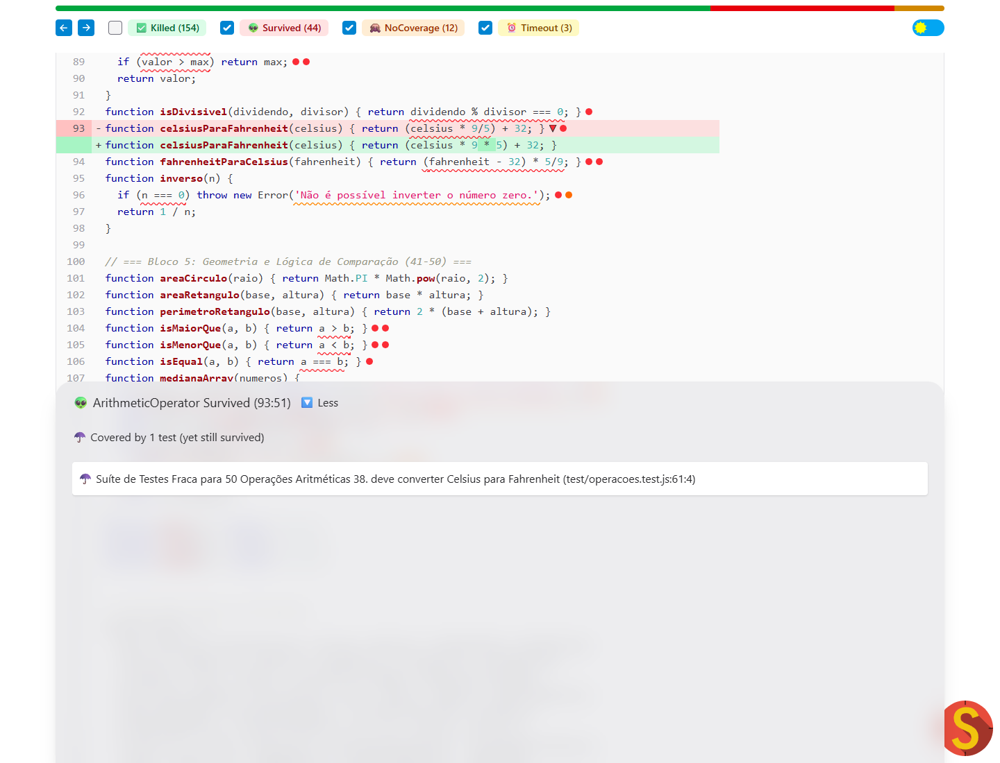

# Análise de eficácia de testes com teste de mutação

Análise realizada em 12/10/2026 no projeto [operacoes-mutante](https://github.com/Victorgabrielcruz/operacoes-mutante). Este relatório apresenta, na ordem em que ocorreram, a preparação, a avaliação inicial, a melhoria dos testes, o resultado intermediário de 97,65% e a alteração posterior que permitiu alcançar 99,51%.

## 1. Objetivo e preparação do ambiente

O objetivo foi avaliar se os testes conseguiam detectar alterações incorretas no código, identificar suas fraquezas e melhorar sua eficácia. A cobertura de código informa quais partes foram executadas; o teste de mutação verifica se os testes percebem mudanças no comportamento esperado.

Foi clonado o fork do projeto, cuja base era o commit `c10621a4fe20f8332e783e06cad0e1b98449aad2`. A biblioteca contém 50 operações matemáticas e utilizava inicialmente 50 testes Jest.

```bash
git clone https://github.com/Victorgabrielcruz/operacoes-mutante.git
cd operacoes-mutante
npm install
npm test
npm test -- --coverage
```

Ambiente utilizado: Windows, Node.js 24.19.0, npm 11.17.0 e Jest 29.7.0. Nesta primeira etapa, o código e os testes originais foram preservados para estabelecer uma referência de comparação.

## 2. Avaliação inicial: cobertura alta, mas testes incompletos

Os **50 testes iniciais passaram**. O relatório de cobertura apresentou:

| Métrica | Resultado inicial |
|---|---:|
| Linhas | 98,64% |
| Instruções | 85,41% |
| Ramificações | 58,82% |
| Funções | 100% |

Embora quase todas as linhas e todas as funções fossem executadas, apenas 58,82% das ramificações eram cobertas. Isso indicava ausência de verificações para decisões alternativas, entradas inválidas e casos de limite. Além disso, executar uma linha não garante que os testes distingam um resultado correto de um incorreto.

Em seguida, foi instalado e configurado o StrykerJS 10.0.0:

```bash
npm install --save-dev @stryker-mutator/core @stryker-mutator/jest-runner
npx stryker init
npx stryker run
```

O assistente gerou `stryker.config.json`, com integração ao Jest. A configuração foi ajustada para aplicar mutações apenas em `src/**/*.js`, analisar a cobertura por teste, gerar relatórios HTML e JSON e usar dois processos. As pastas de evidências e relatórios foram excluídas da cópia do ambiente temporário; isso não exclui mutantes do código de produção.

A primeira análise de mutação produziu:

| Resultado | Quantidade |
|---|---:|
| Mutantes gerados | 213 |
| Mortos (Killed) | 154 |
| Detectados por tempo limite (Timeout) | 3 |
| Sobreviventes (Survived) | 44 |
| Sem cobertura (NoCoverage) | 12 |
| Erros de mutantes | 0 |

A pontuação inicial foi **73,71%**, calculada pelo Stryker como `(154 + 3) / 213 × 100`. Timeouts entram como mutantes detectados porque a alteração fez a execução exceder o limite permitido.

A diferença entre **98,64% de cobertura de linhas** e **73,71% de pontuação de mutação** mostrou que os testes executavam grande parte do código, mas não verificavam todos os comportamentos relevantes. Havia 44 alterações executadas que não provocavam falhas, além de 12 mutantes sem cobertura.


Evidências: [cobertura inicial](evidence/initial/coverage.txt), [relatório inicial do Stryker](evidence/initial/mutation/mutation.html) e [log da análise](evidence/initial/stryker-run.txt).

## 3. Investigação de três mutantes sobreviventes

### 3.1. Comparação sem verificar argumentos iguais

O mutante **183**, do tipo `EqualityOperator`, alterou o retorno de `isMaiorQue(a, b)` de `a > b` para `a >= b`.

O teste original usava somente `isMaiorQue(10, 5)`. As duas versões retornam `true` para essa entrada, então a mutação não era percebida. A fraqueza estava na ausência do caso em que os argumentos são iguais.



### 3.2. Paridade retornando sempre verdadeiro

O mutante **68**, do tipo `ConditionalExpression`, substituiu a expressão `n % 2 === 0` de `isPar` por `true`.

O teste existente verificava somente `isPar(100)`, cujo resultado esperado já era `true`. Uma implementação que aceitasse qualquer número como par também passaria. Faltava uma entrada ímpar com resultado esperado `false`.



### 3.3. Conversão de temperatura testada apenas com zero

O mutante **160**, do tipo `ArithmeticOperator`, alterou `(celsius * 9 / 5) + 32` para `(celsius * 9 * 5) + 32`.

O único teste utilizava `celsiusParaFahrenheit(0)`. Como a multiplicação por zero anula o fator de conversão nas duas versões, ambas retornavam 32. A entrada escolhida não era capaz de revelar o erro na fórmula.



## 4. Melhoria dos testes existentes e adição de novos casos

Foram mantidos os 50 testes originais, fortalecidas suas asserções e adicionados **67 casos**, totalizando **117 testes**. Durante toda esta etapa, `src/operacoes.js` permaneceu idêntico ao código inicial.

As mudanças incluíram:

- Verificar a mensagem esperada ao dividir por zero, em vez de aceitar qualquer erro.
- Testar resultados verdadeiros e falsos em paridade, divisibilidade, primalidade e comparações.
- Exercitar zero, valores negativos, entradas inválidas e limites de intervalos.
- Verificar arrays vazios, arrays com um elemento e combinações de positivos e negativos.
- Testar a mediana com dados desordenados, ordenação numérica e quantidade par de elementos, preservando o array recebido.
- Verificar os primeiros termos de Fibonacci e o fatorial de 0, 1, 2 e 5, além do caso inicial de 4 e da rejeição de negativos.
- Usar temperaturas diferentes de zero e casos de referência conhecidos.

Para os três exemplos investigados, as verificações decisivas foram:

```javascript
expect(isMaiorQue(5, 5)).toBe(false);
expect(isPar(7)).toBe(false);
expect(celsiusParaFahrenheit(100)).toBe(212);
```

Esses resultados distinguem o código correto das alterações simuladas: a comparação inclusiva retorna `true` para argumentos iguais; a paridade constante aceita 7; e o fator incorreto de temperatura deixa de produzir 212.

Também foi testada a preservação de `-0` e `+0` em `clamp`. As comparações numéricas consideram esses zeros iguais, mas `Object.is`, usado pelo matcher `toBe`, distingue seus sinais. Isso permitiu detectar duas alterações de comparações estritas para inclusivas nos limites de zero.

Foi ainda ajustada a configuração do Jest para coletar apenas `src/` e `test/`, com cobertura de `src/**/*.js`. Assim, resíduos de sandboxes do Stryker não eram confundidos com o projeto original. Foram adicionados o script `npm run mutate` e o versionamento do `package-lock.json` para reproduzir as dependências.

## 5. Primeira validação das melhorias: resultado de 97,65%

Após melhorar os testes, foram executados novamente:

```bash
npm test
npm test -- --coverage
npx stryker run
```

Os **117 testes passaram**, e a cobertura chegou a **100% em linhas, instruções, ramificações e funções**. Mantendo o código de produção e a mesma base de 213 mutantes, a análise apresentou:

| Resultado | Após melhorar os testes |
|---|---:|
| Mutantes gerados | 213 |
| Mortos | 202 |
| Tempo limite | 6 |
| Sobreviventes | 5 |
| Sem cobertura | 0 |
| Erros de mutantes | 0 |
| Pontuação de mutação | **97,65%** |

A pontuação passou de **73,71% para 97,65%**, um ganho de **23,94 pontos percentuais** causado pela melhoria dos testes sobre a mesma base de mutantes. Os três mutantes destacados nos prints, IDs 183, 68 e 160, passaram de `Survived` para `Killed`.

Neste momento, a meta de superar 98% **ainda não havia sido alcançada**. Foi necessário investigar os cinco sobreviventes restantes antes de decidir o próximo passo.

Evidências desta etapa: [relatório de 97,65%](evidence/final/mutation/mutation.html), [log do Stryker](evidence/final/stryker-run.txt), [cobertura](evidence/final/coverage.txt) e [comparação dos 213 mutantes](evidence/final/comparacao-mutantes.csv). A análise detalhada desta medição está preservada em [ANALISE_TESTES.md](ANALISE_TESTES.md).

## 6. Investigação dos cinco sobreviventes restantes

A leitura do código mostrou que os cinco sobreviventes eram equivalentes no domínio da biblioteca: números para fatorial e arrays numéricos comuns para produto, sem redefinir métodos ou usar proxies com efeitos colaterais. Eles alteravam a escrita do código, mas preservavam seus resultados nesse domínio.

| ID na etapa de 97,65% | Mutação | Por que o resultado permanece igual |
|---|---|---|
| 31 | Condição `n === 0 || n === 1` do fatorial vira `false` | Para 0 e 1, o laço começa em 2 e não executa. O acumulador permanece 1, igual ao retorno antecipado. Nas outras entradas, esse retorno já não ocorria. |
| 32 | O operador `||` vira `&&` nessa condição | A conjunção nunca é verdadeira para um número. O efeito é remover o retorno antecipado, mantendo o resultado como no caso anterior. |
| 33 | O termo `n === 0` vira `false` | Para 0, o laço não executa e retorna 1. Para 1, o outro termo ainda produz o retorno antecipado. |
| 35 | O termo `n === 1` vira `false` | Para 1, o laço não executa e retorna 1. Para 0, o outro termo ainda produz o retorno antecipado. |
| 140 | A verificação de array vazio de `produtoArray` vira `false` | O `reduce` de um array vazio com acumulador inicial 1 já retorna 1. Para arrays não vazios, o mesmo `reduce` é executado nas duas versões. |

O resultado de **97,65% foi mantido e documentado**. Não foram excluídos esses mutantes nem alterados manualmente seus status. Escrever novos testes de resultados não distingue implementações equivalentes no domínio considerado.

O Stryker reconhece a existência de mutantes equivalentes em sua [documentação oficial](https://stryker-mutator.io/docs/stryker-js/disable-mutants/). Em vez de configurar sua exclusão, a etapa seguinte simplificou o trecho redundante do fatorial.

## 7. Etapa posterior: simplificação do fatorial

Somente após a medição de 97,65% e a análise dos equivalentes, houve uma alteração no código de produção. Foi removido o retorno antecipado redundante do fatorial:

```diff
-  if (n === 0 || n === 1) return 1;
+  // Para 0 e 1, o laço não executa e o acumulador já contém o resultado 1.
```

A função continua inicializando `resultado = 1` e iterando de 2 até `n`. Para 0 e 1, não há iteração e a função retorna 1. Para os demais números, o retorno antecipado já não ocorria; a rejeição de negativos também foi preservada. Portanto, os resultados permanecem iguais no domínio numérico da biblioteca.

Essa simplificação retirou sete mutações possíveis do trecho: **quatro sobreviventes equivalentes e três mutantes que os testes já matavam**. A base passou de **213 para 206 mutantes**. As evidências das execuções anteriores foram preservadas.

Não houve nova exclusão de mutadores ou de mutantes na configuração. Foi adicionado `thresholds.break = 98` para que futuras análises falhem caso a pontuação fique abaixo de 98%.

## 8. Segunda validação: meta atingida com 99,51%

Após a simplificação, os testes, a cobertura e o Stryker foram executados novamente:

```bash
npm test
npm test -- --coverage --coverageDirectory=evidence/meta98/coverage
npx stryker run
```

Os comandos concluíram com código de saída 0. Os **117 testes continuaram passando**, com **100% de cobertura** em todas as métricas. O Stryker apresentou:

| Resultado | Após simplificar o fatorial |
|---|---:|
| Mutantes gerados | 206 |
| Mortos | 198 |
| Tempo limite | 7 |
| Sobreviventes | 1 |
| Sem cobertura | 0 |
| Erros de mutantes | 0 |
| Pontuação de mutação | **99,51%** |

O cálculo foi `(198 + 7) / 206 × 100 = 99,51%`, superando a meta de 98%. O Stryker também confirmou a aprovação do limite configurado. A distribuição entre mortos e timeouts pode variar entre execuções; ambas as categorias são consideradas detectadas.

Restou um equivalente em `produtoArray([])`, com ID **133 na execução mais recente**, correspondente ao antigo ID 140. O `reduce` com acumulador inicial 1 continua retornando 1 para um array vazio, mesmo sem o retorno antecipado. Esse sobrevivente foi mantido no relatório e na pontuação.

Como os IDs foram renumerados, a comparação entre esta execução e a anterior deve usar arquivo, posição, tipo e substituição. A [comparação da refatoração](evidence/meta98/comparacao-refatoracao.csv) registra os correspondentes e os sete mutantes que deixaram de existir.

## 9. Evolução completa dos resultados

| Métrica | Código e testes iniciais | Após melhorar os testes | Após simplificar o fatorial |
|---|---:|---:|---:|
| Testes aprovados | 50 | 117 | 117 |
| Cobertura de linhas | 98,64% | 100% | 100% |
| Cobertura de instruções | 85,41% | 100% | 100% |
| Cobertura de ramificações | 58,82% | 100% | 100% |
| Cobertura de funções | 100% | 100% | 100% |
| Mutantes gerados | 213 | 213 | 206 |
| Mortos | 154 | 202 | 198 |
| Tempo limite | 3 | 6 | 7 |
| Sobreviventes | 44 | 5 | 1 |
| Sem cobertura | 12 | 0 | 0 |
| Erros de mutantes | 0 | 0 | 0 |
| Pontuação de mutação | **73,71%** | **97,65%** | **99,51%** |

A comparação que demonstra o ganho causado pelos testes é **73,71% → 97,65%**, mantendo a mesma base de 213 mutantes e o código original. A passagem posterior para **99,51%** ocorreu após a simplificação do código e usa uma base menor. Esses dois ganhos têm causas diferentes e devem ser apresentados dessa forma.

Se a avaliação exigir que o código de produção permaneça intacto, a medição correspondente é a etapa de 97,65%, acompanhada da justificativa dos cinco equivalentes. O resultado de 99,51% comprova a meta na versão que inclui a simplificação descrita.

## 10. Evidências e conclusão

As três execuções foram preservadas separadamente:

- **Inicial:** [relatório HTML](evidence/initial/mutation/mutation.html), [JSON](evidence/initial/mutation/mutation.json), [cobertura](evidence/initial/coverage.txt) e os quatro prints apresentados neste documento.
- **Após melhorar os testes:** [relatório HTML de 97,65%](evidence/final/mutation/mutation.html), [JSON](evidence/final/mutation/mutation.json), [log dos testes](evidence/final/npm-test.txt) e [comparação dos 213 mutantes](evidence/final/comparacao-mutantes.csv).
- **Após simplificar o fatorial:** [relatório HTML de 99,51%](evidence/meta98/mutation/mutation.html), [JSON](evidence/meta98/mutation/mutation.json), [log do Stryker](evidence/meta98/stryker-run.txt), [log dos testes](evidence/meta98/npm-test.txt), [cobertura](evidence/meta98/coverage.txt), [configuração usada](evidence/meta98/stryker.config.json) e [cópia do código analisado](evidence/meta98/operacoes.js).

Os prints são da execução inicial. Não foram gerados prints novos das execuções posteriores, pois a automação do navegador bloqueou a navegação a relatórios locais. Os relatórios HTML foram preservados e podem ser abertos manualmente para capturar essas telas.

O trabalho demonstrou que a cobertura alta não garante testes eficazes. A investigação dos sobreviventes orientou novos casos e melhores asserções, levando a 97,65% sem alterar a produção. A análise dos equivalentes, realizada depois desse resultado, identificou a redundância do fatorial; sua simplificação permitiu alcançar 99,51%, com todos os testes aprovados. A apresentação das etapas mantém visíveis tanto a melhoria dos testes quanto a alteração posterior da base de mutação.

Este documento é o texto consolidado da análise. O PDF não foi montado, conforme solicitado.
